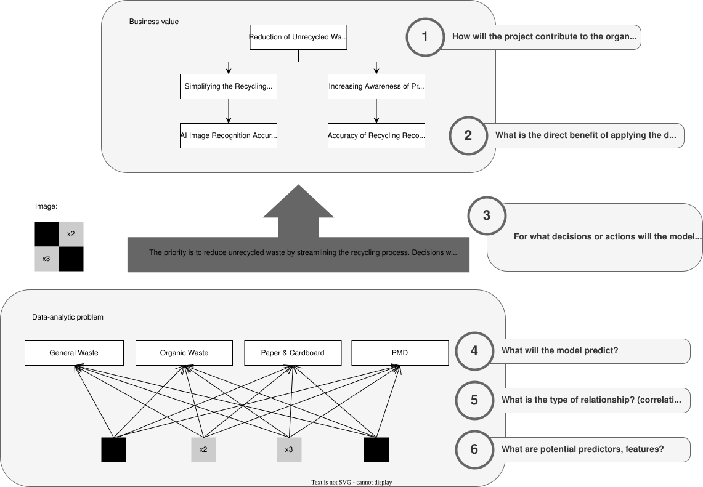

# Product and user research

The classifier is the AI behind **Smart Bin**, an app prototype that tells you which bin an item belongs in from a photo. This page summarises the business and user research done around it.

## The problem

Many people want to recycle but aren't sure which bin an item belongs in, and the rules differ between cities. The project's market research found:

- **Uncertainty:** 48% of people are unsure how to recycle certain items (Recycle Now, 2021).
- **Low recycling rates:** only about 32% of US waste is recycled (US EPA).
- **Contamination:** wrongly sorted items can get whole recycling loads rejected.
- **A gap in existing apps:** apps such as iRecycle and Recycle Coach make users search for each item by name instead of recognising it from a photo.

## Stakeholders

| | Low interest | High interest |
|---|---|---|
| **High power** | Context setters: government and policy makers, investors | Players: municipal waste management, tech developers |
| **Low power** | Crowd: non-users, small businesses | Subjects: consumers, environmental organisations |

The main stakeholder is the consumer. They need:

- quick classification from a photo
- clear disposal instructions that follow local rules
- an app simple enough to keep using

## Decision framework

- **Business value:**
  - Reduce unrecycled waste.
  - Make recycling simpler.
  - Raise awareness of proper disposal.
- **Decision framework:** image recognition accuracy, fast responses and a basic interface come first. Local recycling guidelines and educational features are secondary.
- **Data-analytic problem:** predict the waste category of each photographed item, one item at a time. The prediction tells the user which bin to use.

## Prototype

The Figma wireframe was designed around these human-centred AI principles:

| Principle | How the prototype addresses it |
|---|---|
| Understandability | The app shows what it detected in the photo and lets the user choose which item to classify. |
| Trust | A feedback button lets users report wrong classifications, which can feed back into training. |
| Human control | The user always makes the final decision; the app only suggests. |
| Accessibility | Large buttons, high contrast, and icons combined with text labels. |
| Context | A personal disposal history and local recycling rules. |

## Think-aloud study (3 participants)

Participants were asked to:

1. Start the app.
2. Take or upload a photo.
3. Read the result.
4. Repeat or go back.

They answered open interview questions afterwards. A thematic analysis found:

- **Simplicity:** participants liked the clean design, including that no login is needed.
- **Navigation:** without a back or reset button after uploading a photo, they weren't sure how to continue.
- **Confidence score:** one participant asked to see how confident the model is in its answer.
- **History:** a list of past scans was requested.

The planned changes were a back or reset button, a confidence score next to the result, and a history section. The scan history was then tested in the A/B test.

## A/B test (10 participants per version)

- **Version A** has a scan history; **version B** has a feedback button.
- After using one version, participants rated it on 7-point Likert items: understanding, intuitiveness, usefulness and enjoyment.
- For perceived usefulness, an independent-samples t-test found **no significant difference** (t(18) = 1.23, p = 0.23).
- The analysis is in [notebooks/03_ab_test_analysis.ipynb](../notebooks/03_ab_test_analysis.ipynb).
